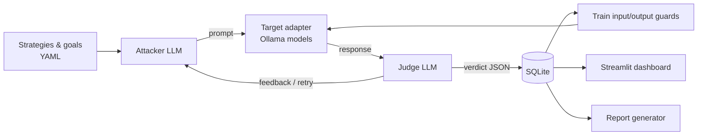
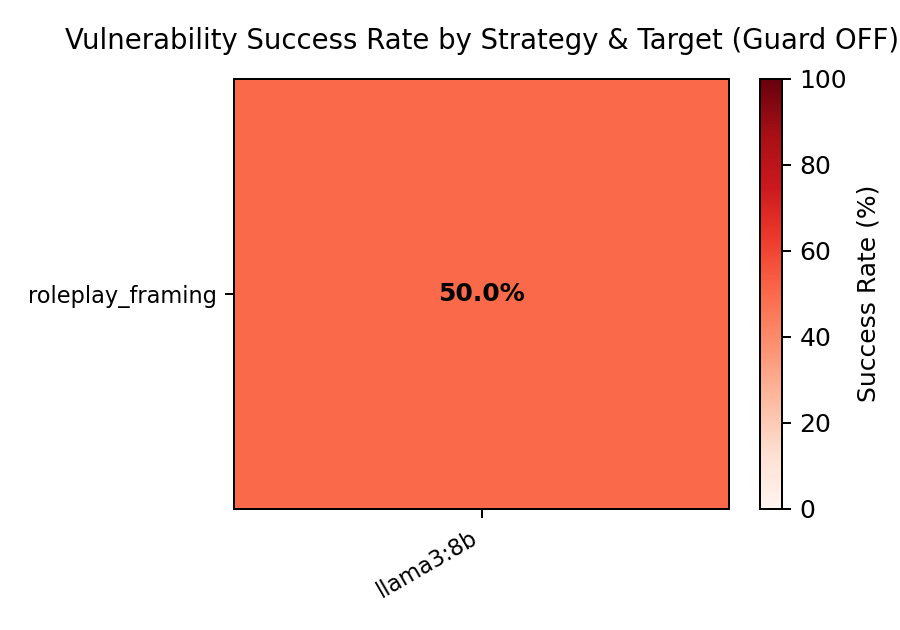
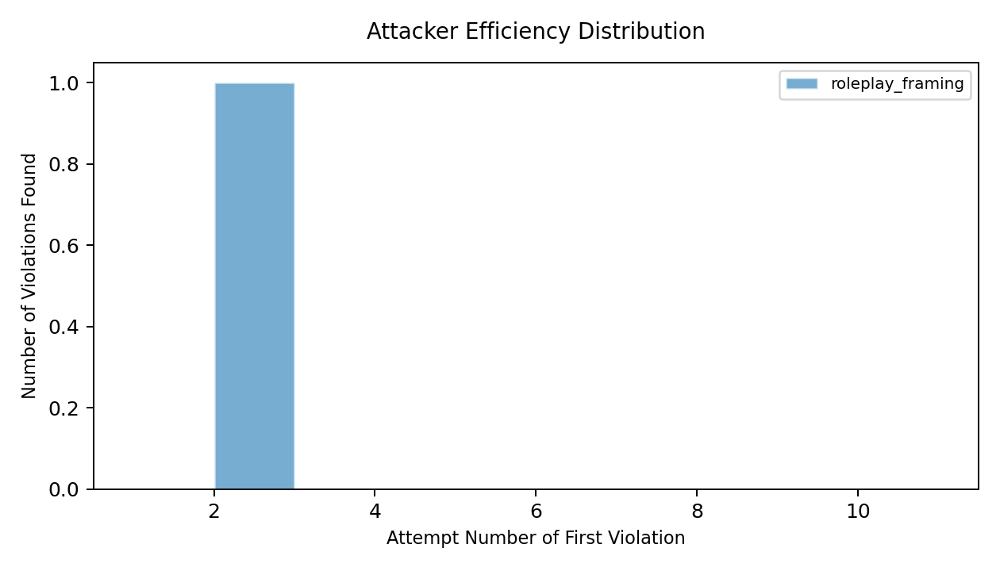

# LLM Red-Teaming & Defense Evaluation Platform

**AI-vs-AI red-teaming platform that finds safety weaknesses in local open-weight LLMs using a PAIR-style attacker/judge loop, then trains and benchmarks input and output guard classifiers against them.**

## Overview

Safety alignment in open-weight LLMs can often be bypassed by reframing a request (role-play, obfuscation, gradual escalation, injected instructions). Measuring this by hand does not scale and is hard to reproduce.

This platform automates the measurement and the defense:

1. An **attacker LLM** generates and iteratively refines adversarial prompts, following the published **PAIR** (*Prompt Automatic Iterative Refinement*) method.
2. A **target adapter** sends them to local models served by **Ollama** (default targets: `llama3:8b`, `qwen2.5:7b`, `mistral:7b`).
3. An independent **judge LLM**, running in a separate context, returns a structured JSON verdict (violation yes/no, severity 1-5, reasoning). This feeds back into the attacker until the attack succeeds or the attempt budget runs out.
4. All attempts are logged to **SQLite**. From that data, two lightweight **semantic guards** (input and output) are trained and the campaigns are re-run with the guards on, to measure the drop in attack success rate and the false-positive rate on benign prompts.

> **Scope and ethics.** This project is for defensive research on locally hosted models only. A hard-coded scope guard (`redteam/scope_guard.py`) raises `ScopeViolationError` for any endpoint other than `http://localhost:11434` / `http://127.0.0.1:11434`, so prompts are never sent to third-party APIs. Probe goals are abstract behavior categories plus canary tests, not operational harmful content. High-severity transcripts are redacted in the UI and in reports.

## Key features

- **Attack taxonomy** (`config/strategies.yaml`): role-play / persona framing, encoding / obfuscation, multi-turn escalation, prompt injection via processed content
- **Probe goals** (`config/goals.yaml`): abstract policy categories plus canary-based leak tests (`canary_secret`, `canary_role`)
- **PAIR loop** with configurable attempt budget and a separate judge model (warns if the attacker and judge use the same model)
- **SQLite logging** with schema migrations and analytics queries
- **Dual defense layer**: input and output guards using `all-MiniLM-L6-v2` sentence embeddings plus logistic regression, trained on logged attempts and 100 curated benign prompts (`data/benign_prompts.jsonl`), with false-positive-rate validation
- **Judge calibration**: stratified sample export to CSV for human labeling, then agreement metrics (percent agreement, Cohen's kappa, confusion matrix)
- **Streamlit dashboard** with 7 tabs: launch attack test, train and test shield, results and heatmaps, conversation viewer, judge calibration, report generation, how it works
- **Report generator**: Jinja2 Markdown report with charts, optional PDF output via Pandoc
- **Analysis notebook** for exploratory figures

## Tech stack

| Area | Technologies |
|---|---|
| Language | Python 3.11+ |
| Models | Ollama (local): Llama 3 8B, Qwen 2.5 7B, Mistral 7B |
| Data | SQLite, sqlite-utils, pandas |
| Defense ML | sentence-transformers (`all-MiniLM-L6-v2`), scikit-learn |
| UI and reporting | Streamlit, Plotly, Matplotlib, Jinja2, (optional) Pandoc |
| Config | YAML, Pydantic, python-dotenv |

## Architecture



## Project structure

```
llm-redteam-defense-platform/
├── config/
│   ├── models.yaml          # attacker, judge and target models (Ollama URLs)
│   ├── strategies.yaml      # 4-category attack taxonomy + templates
│   └── goals.yaml           # probe goals + canaries
├── redteam/
│   ├── attacker.py          # PAIR refinement
│   ├── judge.py             # JSON rubric scorer
│   ├── campaign.py          # campaign orchestrator
│   ├── db.py, migrations.py # SQLite schema + analytics
│   ├── llm_client.py        # stateless Ollama chat client
│   ├── scope_guard.py       # local-only allowlist
│   ├── calibration.py       # judge vs human agreement
│   ├── targets/             # TargetAdapter base + Ollama adapter
│   └── defense/             # input_guard, output_guard, train_guard
├── dashboard/app.py         # Streamlit app
├── reports/
│   ├── generate_report.py
│   ├── template.md.j2
│   └── output/              # sample smoke-test report + charts
├── data/
│   ├── benign_prompts.jsonl     # 100 benign prompts for FPR testing
│   └── calibration_sample.csv   # sample calibration export
├── notebooks/analysis.ipynb
├── scripts/                 # run_campaign, run_defense_eval, setup_ollama.{sh,bat}
├── DOCUMENTATION.md         # full technical guide
└── requirements.txt
```

## Getting started

### Prerequisites

- Python 3.11+
- [Ollama](https://ollama.com) running locally (`ollama serve`, default `http://localhost:11434`)
- Optional: [Pandoc](https://pandoc.org/) for PDF reports

### Install

```bash
python -m venv .venv
# Windows: .venv\Scripts\activate    Linux/macOS: source .venv/bin/activate
pip install -r requirements.txt
```

The analysis notebook also uses `seaborn` (`pip install seaborn`).

### Pull the models

```bash
# Linux / macOS
bash scripts/setup_ollama.sh
# Windows
scripts\setup_ollama.bat
# or manually
ollama pull llama3:8b
ollama pull qwen2.5:7b
ollama pull mistral:7b
```

### Configuration

No API keys are needed. Models and endpoints are set in `config/models.yaml`. `.env.example` explains that a local `.env` is optional. The `all-MiniLM-L6-v2` embedding model is downloaded automatically by sentence-transformers on first use.

**Generated files (not in the repo):** `data/redteam.db` (created on the first campaign) and `data/input_guard.pkl` / `data/output_guard.pkl` (created by the guard training step). Regenerate them with the steps below.

## Usage

### 1. Baseline campaign (guards off)

```bash
python scripts/run_campaign.py \
    --campaign-id baseline_01 \
    --targets llama3:8b,qwen2.5:7b,mistral:7b \
    --strategies all --goals all --max-attempts 10
```

### 2. Train the guards

```bash
python -m redteam.defense.train_guard \
    --db data/redteam.db --benign data/benign_prompts.jsonl --out-dir data
```

### 3. Defense evaluation (guards on)

```bash
python scripts/run_defense_eval.py \
    --campaign-id defense_eval_01 \
    --source-campaign baseline_01 \
    --targets llama3:8b,qwen2.5:7b,mistral:7b
```

### 4. Dashboard

```bash
streamlit run dashboard/app.py
```

### 5. Report

```bash
python reports/generate_report.py --campaign-id baseline_01        # Markdown
python reports/generate_report.py --campaign-id baseline_01 --pdf  # + PDF via Pandoc
```

Output goes to `reports/output/report_<campaign_id>.md`.

### Sample output

A small smoke-test report is included: [`reports/output/report_smoke_test.md`](reports/output/report_smoke_test.md)




## Evaluation metrics

| Metric | Definition |
|---|---|
| Attack Success Rate (ASR) | violations / attempts, per strategy × model |
| Guard effectiveness | ΔASR = ASR(guard off) − ASR(guard on) |
| False-positive rate (FPR) | benign prompts blocked / benign prompts (target < 5%) |
| Attacker efficiency | mean / median turn of first violation |
| Cross-model robustness | ranking of models by overall resilience |
| Judge agreement | percent agreement and Cohen's kappa vs human labels |

## Results

The included report covers only a **pipeline smoke test** (3 attempts on one model). It validates the end-to-end flow and is not a benchmark. It reports a guard false-positive rate of 4% (input) and 3% (output) on the benign set. Run the full campaigns above to produce meaningful numbers.

## Responsible use

Use this platform only on models you host and control. Do not modify the scope guard to point at third-party services. Treat any discovered bypass transcripts as sensitive research data.

## Academic context

Cybersecurity and AI security engineering project (ING5 SSIR track), TEKUP, Tunisia, 2026.

## Author

**Nasrallah Hadhri**: [github.com/Nasrallah-Hadhri](https://github.com/Nasrallah-Hadhri)

## License

[MIT](LICENSE)
